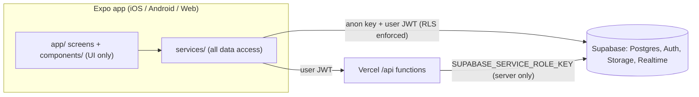

# DocuDash — Project Master File

> Living source of truth for scope, progress, and operational state. Updated at the end of every phase.

**Last updated:** 2026-11-25 (end of Phase 2)
**Current phase:** Phase 2 — Database & Security Layer — `[x] Completed`
**Next phase:** Phase 3 — Modular Service Layer & Vercel API — `[ ] Pending` (awaiting go-ahead)

---

## 1. Project Metadata

| Field | Value |
| --- | --- |
| App name | DocuDash: A Barangay Document Pre-Processing and Scheduled Pickup Application |
| Version | 1.0.0 |
| Repository path | `HighOnKohi/DocuDash` → app root at `DocuDash/` (this folder) |
| Target platforms | Android, iOS (Expo native builds), Web (Expo Web on Vercel) |
| Language | TypeScript (strict, plus `noUncheckedIndexedAccess`) |
| Framework | Expo SDK 58, React Native 0.88, React 19.3, Expo Router 58 (file-based, typed routes) |
| Styling | NativeWind 4.2 (Tailwind CSS 3.4) with DocuDash design tokens |
| Icons | `@expo/vector-icons/MaterialIcons` only — no emojis in UI |
| Backend | Supabase: PostgreSQL, Auth, private Storage, Realtime |
| Hosting / server API | Vercel: static Expo Web export (`dist/`) + Serverless Functions in `api/` |
| Design system | Light mode only. Primary `#991B1B`, hover/active `#B91C1C`, surfaces `#FFFFFF`, muted bg `#F8FAFC`, borders `#E2E8F0`, ink `#0F172A` |

### Architecture Summary

- **UI layer** (`app/`, `components/`): rendering and navigation only. No Supabase queries or business rules.
- **Service layer** (`services/`): the only place that talks to Supabase (anon key) or `/api`.
- **Database layer** (`supabase/migrations/`): RLS on every table, `is_staff()` SECURITY DEFINER helper, atomic `book_pickup_slot()` RPC, private `requirements` bucket with path-scoped policies.
- **Server layer** (`api/`): privileged operations (QR verification, notifications) using the service role key, which is never shipped to clients.

---

## 2. Phase & Task Progress Tracker

Legend: `[ ] Pending` · `[~] In Progress` · `[x] Completed`

### Phase 1 — Foundation & Project Tracking — `[x] Completed` (2026-11-24)

- [x] Audit existing Expo SDK 58 template; remove tutorial screens, components, hooks, and sample assets — 2026-11-24 — kept app icons/splash only.
- [x] Move routing from `src/app/` to root-level `app/` to match the agreed architecture; `@/*` alias now maps to project root — 2026-11-24
- [x] Install NativeWind 4.2.7 + Tailwind CSS 3.4 (Babel `jsxImportSource`, `nativewind/babel`, `withNativeWind` Metro wrapper, `nativewind-env.d.ts`) — 2026-11-24
- [x] Define design tokens in `tailwind.config.js` (`primary`, `surface`, `border`, `ink`) mirrored in `constants/theme.ts` — 2026-11-24
- [x] Install foundation runtime deps: `@expo/vector-icons`, `@supabase/supabase-js`, `@react-native-async-storage/async-storage`, `react-native-url-polyfill` — 2026-11-24 — via `npx expo install` for SDK-compatible versions.
- [x] Configure `app.json`: light UI, `web.bundler=metro`, `web.output=single` (SPA), bundle IDs `ph.gov.barangay.docudash` — 2026-11-24
- [x] Harden `tsconfig.json` (strict, `noUncheckedIndexedAccess`, `noImplicitOverride`) — 2026-11-24
- [x] Block `api/` and `supabase/` from the Metro bundle (root-anchored `resolver.blockList`) so server code cannot leak into the client — 2026-11-24
- [x] Create `vercel.json` (static export to `dist/`, SPA rewrite excluding `/api/*`, security headers, function limits) — 2026-11-24
- [x] Create `.env.example` with separated client and server-only variables; `.gitignore` excludes all `.env*` except the example — 2026-11-24
- [x] Root layout (`app/_layout.tsx`) with global CSS, light navigation theme, headerless stack — 2026-11-24
- [x] Public landing screen (`app/index.tsx`) + stateless `BrandMark` and `FeatureCard` components — 2026-11-24
- [x] ESLint (`eslint-config-expo` flat config) and Prettier (`prettier-plugin-tailwindcss`) — 2026-11-24
- [x] Verification: `tsc --noEmit`, `expo lint`, `expo export -p web` — 2026-11-24 — see Section 5 for results.
- [x] Create `PROJECT.md` with full roadmap — 2026-11-24

### Phase 2 — Database & Security Layer — `[x] Completed` (2026-11-25)

- [x] `supabase/migrations/001_schema.sql` — enums (`user_role`, `request_status`), tables `profiles`, `document_types`, `pickup_slots`, `requests`, `request_attachments`, `audit_logs`; constraints (`booked_count <= max_capacity`, `privacy_consent_at NOT NULL`, unique `qr_token`, QR/status coupling), indexes, `updated_at` trigger, `handle_new_user` profile trigger (enforces RA 10173 consent and forces `'resident'` role), append-only `audit_logs` triggers, Realtime publication — 2026-11-25
- [x] Seed `document_types`: Barangay Clearance, Certificate of Indigency, Certificate of Residency, Business Clearance (fees + `required_docs` JSONB) — 2026-11-25
- [x] `002_rls_policies.sql` — RLS on all 6 tables; `public.is_staff()` & `public.is_admin()` SECURITY DEFINER (pinned `search_path`); least-privilege grants; resident own-row SELECT/INSERT; column-protection triggers blocking resident changes to `role`, `status`, `reviewed_by`, `qr_token`, `pickup_slot_id`, `completed_at`; staff workflow state machine with server-side 256-bit `qr_token` generation (`extensions.gen_random_bytes`) on transition to `ready`; append-only `audit_logs` — 2026-11-25
- [x] `003_rpc_functions.sql` — `book_pickup_slot(p_request_id, p_slot_id)` with deadlock-free `SELECT ... FOR UPDATE`, ownership and capacity checks, slot release on re-book; `release_slot_on_reject` trigger; server-only `verify_pickup(p_qr_token, p_staff_id)` RPC — 2026-11-25
- [x] `004_storage.sql` — private `requirements` bucket (5 MiB limit; JPEG/PNG/WebP/PDF), `{user_id}/{request_id}/{filename}` path policies for residents, staff read-all for 60s signed URLs — 2026-11-25
- [x] Data retention function `get_expired_attachment_paths(p_retention_days default 30)` for purging ID attachments 30 days after completion/rejection (RA 10173) — 2026-11-25
- [x] `types/database.ts` — typed `Database` definition for `@supabase/supabase-js` v2 generics plus domain aliases and API payload/response contracts — 2026-11-25

### Phase 3 — Modular Service Layer & Vercel API — `[ ] Pending`

- [ ] `services/supabase.ts` — typed client (anon key only), platform-aware session storage, URL polyfill.
- [ ] `services/authService.ts` — register (with consent timestamp), login, logout, session/profile retrieval, auth state listener.
- [ ] `services/requestService.ts` — create/list/get requests, staff status transitions, Realtime subscriptions.
- [ ] `services/storageService.ts` — path-convention uploads, 60-second signed URLs for staff.
- [ ] `services/scheduleService.ts` — list/manage slots, call `book_pickup_slot` RPC.
- [ ] `services/auditService.ts` — append audit entries, read audit trail (staff).
- [ ] `api/verify-pickup.ts` — authenticate staff JWT, validate QR token, mark `completed`, write audit log (service role).
- [ ] `api/notify-resident.ts` — staff-authenticated status / pickup alert dispatch.
- [ ] Shared API helpers (CORS allow-list, JSON errors, auth extraction) and `@vercel/node` types.

### Phase 4 — Auth & Resident Application — `[ ] Pending`

- [ ] Root auth/role guard in `app/_layout.tsx` (redirect by session and `profiles.role`).
- [ ] `(auth)/login.tsx` and `(auth)/register.tsx` with explicit RA 10173 consent checkbox and notice.
- [ ] `(resident)/index.tsx` — dashboard with active requests and live status.
- [ ] `(resident)/request-new.tsx` — document selection, purpose form, ID upload, slot picker.
- [ ] `(resident)/request/[id].tsx` — real-time status tracker and QR pickup pass.
- [ ] `(resident)/profile.tsx` — profile and privacy settings.
- [ ] Reusable components (buttons, inputs, status badge, cards, empty/error states).

### Phase 5 — Barangay Admin Web Portal — `[ ] Pending`

- [ ] `(admin)/_layout.tsx` — desktop sidebar navigation, staff-only guard.
- [ ] `(admin)/index.tsx` — queue overview and daily pickup metrics.
- [ ] `(admin)/requests/[id].tsx` — requirement viewer via 60-second signed URLs, approve / reject with reason.
- [ ] `(admin)/schedules.tsx` — pickup date, time window, and capacity management.
- [ ] `(admin)/scanner.tsx` — QR scan (camera) plus manual token entry, calls `/api/verify-pickup`.

### Phase 6 — Complete Documentation & Final Audit — `[ ] Pending`

- [ ] `README.md` (app-level) — overview, setup, quickstart.
- [ ] `docs/ARCHITECTURE.md`, `docs/SECURITY.md`, `docs/API_AND_DB.md`, `docs/DEPLOYMENT.md`.
- [ ] Security review: RLS matrix vs. code paths, secret scan, bundle check for service key.
- [ ] Full TypeScript, lint, and web export verification.
- [ ] Finalize this file with 100% status accuracy.

---

## 3. File Inventory

Paths are relative to the app root (`DocuDash/`).

| File | Purpose | Status |
| --- | --- | --- |
| `PROJECT.md` | Living project master file and progress tracker | Created (Phase 1) |
| `package.json` | Dependencies and scripts (`start`, `web`, `build:web`, `typecheck`, `lint`, `doctor`) | Updated (Phase 1) |
| `app.json` | Expo config: light UI, Metro web bundler, SPA output, bundle IDs | Updated (Phase 1) |
| `tsconfig.json` | Strict TS config, `@/*` → project root | Updated (Phase 1) |
| `babel.config.js` | `babel-preset-expo` with NativeWind JSX import source | Created (Phase 1) |
| `metro.config.js` | NativeWind Metro wrapper; blocks `api/` and `supabase/` from bundle | Created (Phase 1) |
| `tailwind.config.js` | Tailwind content paths, NativeWind preset, design tokens | Created (Phase 1) |
| `global.css` | Tailwind layer directives | Created (Phase 1) |
| `nativewind-env.d.ts` | `className` typings for React Native | Created (Phase 1) |
| `eslint.config.js` | ESLint flat config (`eslint-config-expo`) | Created (Phase 1) |
| `.prettierrc` | Prettier config with Tailwind class sorting | Created (Phase 1) |
| `vercel.json` | Vercel build, SPA rewrite (excludes `/api`), headers, function limits | Created (Phase 1) |
| `.env.example` | Client vs. server-only environment variable template | Created (Phase 1) |
| `.gitignore` | Adds `.vercel/` and `.env*` (except `.env.example`) | Updated (Phase 1) |
| `constants/theme.ts` | Raw color tokens and desktop breakpoint | Created (Phase 1) |
| `types/assets.d.ts` | Ambient `*.css` module declaration (TS 6 side-effect import checking) | Created (Phase 1) |
| `app/_layout.tsx` | Root layout: global CSS, light theme, stack (auth guard in Phase 4) | Created (Phase 1) |
| `app/index.tsx` | Public landing screen | Created (Phase 1) |
| `components/BrandMark.tsx` | Logo lockup (Material Icon + wordmark) | Created (Phase 1) |
| `components/FeatureCard.tsx` | Stateless icon/title/description card | Created (Phase 1) |
| `AGENTS.md` | Agent guidance (routing note updated to root `app/`) | Updated (Phase 1) |
| `supabase/migrations/001_schema.sql` | Tables, enums, constraints, indexes, triggers, Realtime, seed | Created (Phase 2) |
| `supabase/migrations/002_rls_policies.sql` | RLS policies, `is_staff()`/`is_admin()`, column guards, QR generation | Created (Phase 2) |
| `supabase/migrations/003_rpc_functions.sql` | `book_pickup_slot()`, reject slot release, `verify_pickup()`, retention helper | Created (Phase 2) |
| `supabase/migrations/004_storage.sql` | Private `requirements` bucket and path-scoped Storage RLS | Created (Phase 2) |
| `types/database.ts` | Shared `Database` generics, domain aliases, API contracts | Created (Phase 2) |
| `services/*.ts` | Service layer (6 files) | Pending (Phase 3) |
| `api/verify-pickup.ts`, `api/notify-resident.ts` | Vercel Serverless Functions | Pending (Phase 3) |
| `app/(auth)/*`, `app/(resident)/*` | Auth and resident screens | Pending (Phase 4) |
| `app/(admin)/*` | Staff portal screens | Pending (Phase 5) |
| `README.md`, `docs/*.md` | Documentation (current `README.md` is the Expo template; replaced in Phase 6) | Pending (Phase 6) |

---

## 4. Environment Variables Checklist

### Client (bundled, `EXPO_PUBLIC_*`) — set in `.env.local`, EAS, and Vercel

- [ ] `EXPO_PUBLIC_SUPABASE_URL` — Supabase project URL.
- [ ] `EXPO_PUBLIC_SUPABASE_ANON_KEY` — anon/public key (safe; RLS enforced).
- [ ] `EXPO_PUBLIC_API_BASE_URL` — absolute Vercel URL for `/api` (required on native; optional on web, defaults to same origin).

### Server-only (Vercel Project Settings → Environment Variables; never `EXPO_PUBLIC_`)

- [ ] `SUPABASE_URL` — same project URL, read by `/api`.
- [ ] `SUPABASE_SERVICE_ROLE_KEY` — bypasses RLS; used only inside `/api`.
- [ ] `ALLOWED_ORIGINS` — comma-separated CORS allow-list for `/api`.
- [ ] `CRON_SECRET` — optional; protects the scheduled retention purge job.

---

## 5. Known Issues & Next Actions

### Verification results (Phase 1)

- `npx tsc --noEmit` — passes (0 errors).
- `npx expo lint` — passes (0 warnings, 0 errors).
- `npx expo export -p web` — succeeds; `dist/` contains `index.html`, Tailwind CSS (design tokens such as `bg-primary`, `border-border`, and `lg:` responsive variants compiled), and the MaterialIcons font.
- `npx expo-doctor` — 20/20 checks passed.
- Bundle secret scan — no `SERVICE_ROLE` references in `dist/` JS.

### Verification results (Phase 2)

- **PostgreSQL migration & security test suite** (executed against ephemeral `supabase/postgres:17.12.0.005` Docker container):
  - All 4 migrations (`001` → `004`) applied cleanly twice (idempotent).
  - Verified 4 seeded `document_types` and private `requirements` bucket (`public = false`).
  - Verified `on_auth_user_created` rejects missing RA 10173 consent and forces `role = 'resident'` even when client passes `role: 'admin'`.
  - Verified residents cannot elevate `role` or tamper with `status`/`qr_token`, and cannot view other residents' requests or storage objects.
  - Verified `book_pickup_slot()` atomically reserves capacity, decrements old slot on re-book, rejects overbooking when full, and `release_slot_on_reject` restores capacity on rejection.
  - Verified staff workflow `pending -> reviewing -> ready` generates a 43-char CSPRNG `qr_token` server-side; `verify_pickup()` is restricted to `service_role`, completes the request atomically, writes `audit_logs`, and rejects replay.
  - Verified `audit_logs` rejects `DELETE`/`UPDATE` even for superusers.
- `npx tsc --noEmit` — passes (0 errors) with `types/database.ts`.

### Known issues / notes

- **App root is nested.** The Expo project lives in `DocuDash/` inside the repository. On Vercel, set **Root Directory = `DocuDash`** so `vercel.json` and `api/` are picked up.
- **`@expo/vector-icons` deprecation notice.** Expo docs mark it as slated for deprecation in favor of `@react-native-vector-icons/*`. It is still the SDK 58-compatible package and is used per project requirements; migrating later is a mechanical import change.
- **NativeWind version.** NativeWind 4.2.7 (stable, Tailwind 3) is used; NativeWind 5 is still a release candidate.
- **`npm audit`** reports 3 moderate advisories in transitive dev tooling from the Expo template; no runtime impact identified. Re-check after Phase 6.

### Pending manual steps

- [ ] Create a Supabase project and copy URL + anon key into `.env.local` (from `.env.example`).
- [ ] Run migrations `001` → `004` in order in the Supabase SQL Editor (or `supabase db push`).
- [ ] Create the Vercel project (Root Directory `DocuDash`) and add server-only variables.

### Next actions

1. Phase 3 — build the separated service layer (`services/*.ts`) and Vercel Serverless Functions (`api/verify-pickup.ts`, `api/notify-resident.ts`).
