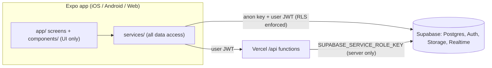

# DocuDash — Project Master File

> Living source of truth for scope, progress, and operational state. Updated at the end of every phase.

**Last updated:** 2026-11-26 (end of Phase 6 — Project Complete)
**Current phase:** Phase 6 — Complete Documentation & Final Audit — `[x] Completed`
**Next phase:** Production deployment & user acceptance testing (all 6 build phases complete)

---

## 1. Project Metadata

| Field | Value |
| --- | --- |
| App name | DocuDash: A Barangay Document Pre-Processing and Scheduled Pickup Application |
| Version | 1.0.0 |
| Repository path | `HighOnKohi/DocuDash` → app root is the repository root |
| Target platforms | Android, iOS (Expo native builds), Web (Expo Web on Vercel) |
| Language | TypeScript (strict, plus `noUncheckedIndexedAccess`) |
| Framework | Expo SDK 58, React Native 0.88, React 19.3, Expo Router 58 (file-based, typed routes) |
| Styling | NativeWind 4.2 (Tailwind CSS 3.4) with DocuDash design tokens |
| Icons | `@expo/vector-icons/MaterialIcons` only — no emojis in UI |
| Backend | Supabase: PostgreSQL, Auth, private Storage, Realtime |
| Hosting / server API | Vercel: static Expo Web export (`dist/`) + Serverless Functions in `api/` |
| Design system | Light mode only. Primary `#991B1B`, hover/active `#B91C1C`, surfaces `#FFFFFF`, muted bg `#F8FAFC`, borders `#E2E8F0`, ink `#0F172A` |

### Architecture Summary

- **UI layer** (`app/`, `components/`): rendering and navigation only. No Supabase queries or business rules.
- **Service layer** (`services/`): the only place that talks to Supabase (anon key) or `/api`.
- **Database layer** (`supabase/migrations/`): RLS on every table, `is_staff()` SECURITY DEFINER helper, atomic `book_pickup_slot()` RPC, private `requirements` bucket with path-scoped policies.
- **Server layer** (`api/`): privileged operations (QR verification, notifications) using the service role key, which is never shipped to clients.

---

## 2. Phase & Task Progress Tracker

Legend: `[ ] Pending` · `[~] In Progress` · `[x] Completed`

### Phase 1 — Foundation & Project Tracking — `[x] Completed` (2026-11-24)

- [x] Audit existing Expo SDK 58 template; remove tutorial screens, components, hooks, and sample assets — 2026-11-24 — kept app icons/splash only.
- [x] Move routing from `src/app/` to root-level `app/` to match the agreed architecture; `@/*` alias now maps to project root — 2026-11-24
- [x] Install NativeWind 4.2.7 + Tailwind CSS 3.4 (Babel `jsxImportSource`, `nativewind/babel`, `withNativeWind` Metro wrapper, `nativewind-env.d.ts`) — 2026-11-24
- [x] Define design tokens in `tailwind.config.js` (`primary`, `surface`, `border`, `ink`) mirrored in `constants/theme.ts` — 2026-11-24
- [x] Install foundation runtime deps: `@expo/vector-icons`, `@supabase/supabase-js`, `@react-native-async-storage/async-storage`, `react-native-url-polyfill` — 2026-11-24 — via `npx expo install` for SDK-compatible versions.
- [x] Configure `app.json`: light UI, `web.bundler=metro`, `web.output=single` (SPA), bundle IDs `ph.gov.barangay.docudash` — 2026-11-24
- [x] Harden `tsconfig.json` (strict, `noUncheckedIndexedAccess`, `noImplicitOverride`) — 2026-11-24
- [x] Block `api/` and `supabase/` from the Metro bundle (root-anchored `resolver.blockList`) so server code cannot leak into the client — 2026-11-24
- [x] Create `vercel.json` (static export to `dist/`, SPA rewrite excluding `/api/*`, security headers, function limits) — 2026-11-24
- [x] Create `.env.example` with separated client and server-only variables; `.gitignore` excludes all `.env*` except the example — 2026-11-24
- [x] Root layout (`app/_layout.tsx`) with global CSS, light navigation theme, headerless stack — 2026-11-24
- [x] Public landing screen (`app/index.tsx`) + stateless `BrandMark` and `FeatureCard` components — 2026-11-24
- [x] ESLint (`eslint-config-expo` flat config) and Prettier (`prettier-plugin-tailwindcss`) — 2026-11-24
- [x] Verification: `tsc --noEmit`, `expo lint`, `expo export -p web` — 2026-11-24 — see Section 5 for results.
- [x] Create `PROJECT.md` with full roadmap — 2026-11-24

### Phase 2 — Database & Security Layer — `[x] Completed` (2026-11-25)

- [x] `supabase/migrations/001_schema.sql` — enums (`user_role`, `request_status`), tables `profiles`, `document_types`, `pickup_slots`, `requests`, `request_attachments`, `audit_logs`; constraints (`booked_count <= max_capacity`, `privacy_consent_at NOT NULL`, unique `qr_token`, QR/status coupling), indexes, `updated_at` trigger, `handle_new_user` profile trigger (enforces RA 10173 consent and forces `'resident'` role), append-only `audit_logs` triggers, Realtime publication — 2026-11-25
- [x] Seed `document_types`: Barangay Clearance, Certificate of Indigency, Certificate of Residency, Business Clearance (fees + `required_docs` JSONB) — 2026-11-25
- [x] `002_rls_policies.sql` — RLS on all 6 tables; `public.is_staff()` & `public.is_admin()` SECURITY DEFINER (pinned `search_path`); least-privilege grants; resident own-row SELECT/INSERT; column-protection triggers blocking resident changes to `role`, `status`, `reviewed_by`, `qr_token`, `pickup_slot_id`, `completed_at`; staff workflow state machine with server-side 256-bit `qr_token` generation (`extensions.gen_random_bytes`) on transition to `ready`; append-only `audit_logs` — 2026-11-25
- [x] `003_rpc_functions.sql` — `book_pickup_slot(p_request_id, p_slot_id)` with deadlock-free `SELECT ... FOR UPDATE`, ownership and capacity checks, slot release on re-book; `release_slot_on_reject` trigger; server-only `verify_pickup(p_qr_token, p_staff_id)` RPC — 2026-11-25
- [x] `004_storage.sql` — private `requirements` bucket (5 MiB limit; JPEG/PNG/WebP/PDF), `{user_id}/{request_id}/{filename}` path policies for residents, staff read-all for 60s signed URLs — 2026-11-25
- [x] Data retention function `get_expired_attachment_paths(p_retention_days default 30)` for purging ID attachments 30 days after completion/rejection (RA 10173) — 2026-11-25
- [x] `types/database.ts` — typed `Database` definition for `@supabase/supabase-js` v2 generics plus domain aliases and API payload/response contracts — 2026-11-25
- [x] **Phase 2 re-audit** — 2026-11-25 — fixed 4 issues (all in place, migrations remain idempotent):
  - Clients could backdate `requests.created_at` (jump the staff queue), `request_attachments.uploaded_at` (dodge the 30-day purge), and `audit_logs.created_at`. New `private.force_insert_timestamps()` trigger now sets these on the server (`audit_logs`: for every role).
  - A rejected request kept pointing at its slot after the capacity was released, so staff got an FK error when deleting the emptied slot. Rejection now clears `pickup_slot_id`.
  - Deleting an account (cascade) leaked slot capacity. `release_slot_on_reject` now also runs on `DELETE` of open requests.
  - Status changes were only audited if the client remembered to write a log. New `private.audit_request_changes()` trigger writes `request_created`, `request_reviewing`, `request_approved` and `request_rejected` automatically (`pickup_verified` stays in `verify_pickup()`).

### Phase 3 — Modular Service Layer & Vercel API — `[x] Completed` (2026-11-25)

- [x] `services/supabase.ts` — typed lazy singleton client (anon key only), platform-aware session storage (SSR-safe `localStorage` on web, `AsyncStorage` + `AppState` token refresh on native), URL polyfill, `ServiceError`, and authenticated `callApi()` helper for `/api/*` — 2026-11-25
- [x] `services/authService.ts` — register (enforces explicit RA 10173 consent timestamp, never sends `role`), login with profile fetch, logout, session/profile retrieval, editable profile update, auth state listener, role helpers — 2026-11-25
- [x] `services/requestService.ts` — document types catalogue, create/edit/list/get requests (disambiguated FK joins), staff workflow transitions (`reviewing`, `ready`, `rejected`), `/api/verify-pickup` & `/api/notify-resident` callers, Realtime subscriptions — 2026-11-25
- [x] `services/storageService.ts` — strict `{user_id}/{request_id}/{filename}` path uploads (`upsert: false`, 5 MiB & MIME validation, orphan cleanup on DB insert failure), attachment deletion, 60-second signed URLs with `attachment_viewed` audit logging — 2026-11-25
- [x] `services/scheduleService.ts` — `Asia/Manila` date filtering, staff slot CRUD, atomic `book_pickup_slot` RPC caller, Realtime slot capacity subscription — 2026-11-25
- [x] `services/auditService.ts` — append audit entries (`actor_id = auth.uid()`), staff audit trail query — 2026-11-25
- [x] `api/verify-pickup.ts` — staff JWT verification, QR format check, server-only `verify_pickup` RPC invocation with status-coded error mapping, hydrated receipt response — 2026-11-25
- [x] `api/notify-resident.ts` — staff-authenticated status/reminder notification dispatch (optional Resend email delivery with in-app Realtime fallback) and data-minimized `notification_dispatched` audit log — 2026-11-25
- [x] Shared API helpers (`api/_lib/supabaseAdmin.ts`, `api/_lib/http.ts`, `api/_lib/auth.ts` for strict CORS allow-list, JSON error handling, staff JWT validation), `@vercel/node` dev types, and restored `functions` (`api/*.ts`, `maxDuration: 10`) in `vercel.json` — 2026-11-25

### Phase 4 — Auth & Resident Application — `[x] Completed` (2026-11-25)

- [x] `contexts/AuthContext.tsx` + root auth/role guard in `app/_layout.tsx` using Expo Router SDK 58 `Stack.Protected` (separates public/`(auth)`, `(resident)`, and `(admin)` by session & `profiles.role`) + splash screen lifecycle — 2026-11-25
- [x] `app/(auth)/login.tsx`, `app/(auth)/register.tsx` (with explicit RA 10173 Data Privacy notice and mandatory consent checkbox), and Sign In / Register CTAs on `app/index.tsx` — 2026-11-25
- [x] `app/(resident)/_layout.tsx` & `app/(resident)/index.tsx` — mobile-first tab navigation, live Realtime dashboard, summary counters, status filters, and ready-for-pickup QR highlight — 2026-11-25
- [x] `app/(resident)/request-new.tsx` — document selection (with fee & required docs checklist), purpose form, `expo-document-picker` private ID uploads (JPG/PNG/WebP/PDF, 5 MiB limit), and live upcoming slot picker — 2026-11-25
- [x] `app/(resident)/request/[id].tsx` — real-time status timeline, vector QR pickup pass (`qrcode` + `react-native-svg`), inline slot booking/re-booking, pending purpose edits, and requirement preview/upload/delete — 2026-11-25
- [x] `app/(resident)/profile.tsx` — contact details editor, recorded RA 10173 consent timestamp, 30-day retention policy summary, and sign out — 2026-11-25
- [x] Reusable components (`Button`, `TextField`, `StatusBadge`, `Card`, `StateView`, `QrCodeMatrix`, `RequestCard`), `constants/format.ts`, and `(admin)` Phase 4 bridge screen — 2026-11-25

### Phase 5 — Barangay Admin Web Portal — `[x] Completed` (2026-11-26)

- [x] `app/(admin)/_layout.tsx` — responsive desktop sidebar (>= 1024px) & mobile top nav bar with defense-in-depth staff/admin guard and sign-out — 2026-11-26
- [x] `app/(admin)/index.tsx` — real-time FIFO queue overview, daily pickup capacity & status metrics, today's slot load bars, status filters, and search — 2026-11-26
- [x] `app/(admin)/requests/[id].tsx` — 60-second signed requirement viewer (live expiry countdown, inline image preview, external PDF open, automatic `attachment_viewed` audit logging), workflow transitions (`Start Review`, `Approve & Issue QR Pass`, `Reject with Reason`), optional `/api/notify-resident` dispatch, and per-request append-only audit trail — 2026-11-26
- [x] `app/(admin)/schedules.tsx` — pickup date, time window, and capacity management (single slot or standard 4-window day helper, inline capacity editing, unbooked deletion, Realtime capacity bars) — 2026-11-26
- [x] `app/(admin)/scanner.tsx`, `components/QrScannerView.tsx` (`expo-camera`), and `components/QrScannerView.web.tsx` (webcam `getUserMedia` + `jsqr`) — camera QR scan plus manual token verification via `/api/verify-pickup`, verified release receipts, and session history — 2026-11-26

### Phase 6 — Complete Documentation & Final Audit — `[x] Completed` (2026-11-26)

- [x] `README.md` (app-level) — full project overview, features, tech stack, folder structure, quickstart, scripts, and links to `docs/` — 2026-11-26
- [x] `docs/ARCHITECTURE.md`, `docs/SECURITY.md`, `docs/API_AND_DB.md`, `docs/DEPLOYMENT.md` — Mermaid system/routing/lifecycle diagrams, verified RLS policy matrix, RA 10173 compliance, schema/RPC/API reference, and Supabase/Vercel/Resend/EAS deployment guides — 2026-11-26
- [x] Security review — verified RLS matrix against `services/` and `api/`, 0 UI direct Supabase imports, 0 emojis in UI, 0 tracked `.env` files, 0 pattern or actual secret leaks in `dist/**/*.js` — 2026-11-26
- [x] Full verification — `tsc --noEmit` (0 errors), `expo lint` (0 errors/warnings), `expo export -p web` (18 bundles), `expo-doctor` (20/20 checks passed) — 2026-11-26
- [x] Finalized `PROJECT.md` with 100% status accuracy — 2026-11-26

---

## 3. File Inventory

Paths are relative to the repository root (`./`).

| File | Purpose | Status |
| --- | --- | --- |
| `PROJECT.md` | Living project master file and progress tracker | Finalized (Phase 6) |
| `package.json` | Dependencies and scripts (`start`, `web`, `build:web`, `typecheck`, `lint`, `doctor`) | Updated (Phase 5) |
| `app.json` | Expo config: light UI, Metro web bundler, SPA output, bundle IDs, `expo-camera` plugin (`recordAudioAndroid: false`) | Updated (Phase 5) |
| `tsconfig.json` | Strict TS config, `@/*` → project root | Updated (Phase 1) |
| `babel.config.js` | `babel-preset-expo` with NativeWind JSX import source | Created (Phase 1) |
| `metro.config.js` | NativeWind Metro wrapper; blocks `api/` and `supabase/` from bundle | Created (Phase 1) |
| `tailwind.config.js` | Tailwind content paths, NativeWind preset, design tokens | Created (Phase 1) |
| `global.css` | Tailwind layer directives | Created (Phase 1) |
| `nativewind-env.d.ts` | `className` typings for React Native | Created (Phase 1) |
| `eslint.config.js` | ESLint flat config (`eslint-config-expo`) | Created (Phase 1) |
| `.prettierrc` | Prettier config with Tailwind class sorting | Created (Phase 1) |
| `vercel.json` | Vercel build, SPA rewrite (excludes `/api`), headers, `api/*.ts` function `maxDuration: 10` | Updated (Phase 3) |
| `.env.example` | Client vs. server-only environment variable template (including optional Resend vars) | Updated (Phase 3) |
| `.gitignore` | Adds `.vercel/` and `.env*` (except `.env.example`) | Updated (Phase 1) |
| `constants/theme.ts` | Raw color tokens and desktop breakpoint | Created (Phase 1) |
| `constants/format.ts` | PHP currency, Asia/Manila date/time, and status label formatters | Created (Phase 4) |
| `contexts/AuthContext.tsx` | Session/profile provider with role helpers and `services/authService` bridge | Created (Phase 4) |
| `types/assets.d.ts` | Ambient `*.css` module declaration (TS 6 side-effect import checking) | Created (Phase 1) |
| `app/_layout.tsx` | Root layout: global CSS, light theme, `AuthProvider`, `Stack.Protected` role guards | Updated (Phase 4) |
| `app/index.tsx` | Public landing screen with Sign In / Register actions | Updated (Phase 4) |
| `components/BrandMark.tsx` | Logo lockup (Material Icon + wordmark) | Created (Phase 1) |
| `components/FeatureCard.tsx` | Stateless icon/title/description card | Created (Phase 1) |
| `components/Button.tsx`, `TextField.tsx`, `Card.tsx`, `StatusBadge.tsx`, `StateView.tsx`, `QrCodeMatrix.tsx`, `RequestCard.tsx` | Reusable light-mode UI component library & vector QR pass renderer | Created (Phase 4) |
| `components/QrScannerView.tsx`, `QrScannerView.web.tsx` | Cross-platform camera QR scanner (`expo-camera` native, webcam + `jsqr` web) | Created (Phase 5) |
| `AGENTS.md` | Agent guidance (routing note updated to root `app/`) | Updated (Phase 1) |
| `supabase/migrations/001_schema.sql` | Tables, enums, constraints, indexes, triggers, Realtime, seed | Created (Phase 2) |
| `supabase/migrations/002_rls_policies.sql` | RLS policies, `is_staff()`/`is_admin()`, column guards, QR generation | Created (Phase 2) |
| `supabase/migrations/003_rpc_functions.sql` | `book_pickup_slot()`, reject slot release, `verify_pickup()`, retention helper | Created (Phase 2) |
| `supabase/migrations/004_storage.sql` | Private `requirements` bucket and path-scoped Storage RLS | Created (Phase 2) |
| `types/database.ts` | Shared `Database` generics, domain aliases, API payload/response/error contracts | Updated (Phase 3) |
| `services/supabase.ts` | Typed client (anon key only), platform storage, `ServiceError`, `/api` caller | Created (Phase 3) |
| `services/authService.ts` | Registration (RA 10173 consent), login/logout, profile & auth state | Created (Phase 3) |
| `services/requestService.ts` | Requests CRUD, staff workflow transitions, `/api` calls, Realtime | Created (Phase 3) |
| `services/storageService.ts` | Path-scoped `requirements` uploads (`upsert: false`), 60s signed URLs | Created (Phase 3) |
| `services/scheduleService.ts` | Pickup slot CRUD, atomic `book_pickup_slot` RPC, Realtime | Created (Phase 3) |
| `services/auditService.ts` | Append-only audit log inserts and staff audit trail queries | Created (Phase 3) |
| `api/_lib/supabaseAdmin.ts` | Server-only Supabase service-role client (blocked from Metro bundle) | Created (Phase 3) |
| `api/_lib/http.ts` | Strict `ALLOWED_ORIGINS` CORS, preflight, security headers, JSON errors | Created (Phase 3) |
| `api/_lib/auth.ts` | Bearer JWT verification + `staff`/`admin` profile role guard | Created (Phase 3) |
| `api/_lib/resend.ts` | Server-only Resend Node SDK client (template sending, idempotency, retries) | Created (Phase 3) |
| `api/verify-pickup.ts` | `POST /api/verify-pickup` — atomic QR pickup verification + receipt | Created (Phase 3) |
| `api/notify-resident.ts` | `POST /api/notify-resident` — staff notification dispatch + audit log | Created (Phase 3) |
| `app/(auth)/_layout.tsx`, `login.tsx`, `register.tsx` | Resident/staff login and RA 10173 registration screens | Created (Phase 4) |
| `app/(resident)/_layout.tsx`, `index.tsx`, `request-new.tsx`, `request/[id].tsx`, `profile.tsx` | Resident tab navigator, dashboard, request form, QR tracker, profile & privacy | Created (Phase 4) |
| `app/(admin)/_layout.tsx`, `index.tsx`, `requests/[id].tsx`, `schedules.tsx`, `scanner.tsx` | Staff web portal: sidebar, queue & metrics, 60s requirement viewer, schedule CRUD, QR scanner | Created (Phase 5) |
| `README.md` | Complete app overview, features, tech stack, setup, quickstart, and scripts | Created (Phase 6) |
| `docs/ARCHITECTURE.md` | System diagrams, 4-layer architecture, `Stack.Protected` routing, QR & Realtime flows | Created (Phase 6) |
| `docs/SECURITY.md` | Full RLS policy matrix vs. code paths, triggers, RA 10173 compliance, secret hygiene | Created (Phase 6) |
| `docs/API_AND_DB.md` | Complete Postgres schema, RPCs, Storage bucket, service layer, and `/api/*` spec | Created (Phase 6) |
| `docs/DEPLOYMENT.md` | Supabase, Resend, Vercel, EAS mobile builds, and RA 10173 retention job guide | Created (Phase 6) |

---

## 4. Environment Variables Checklist

### Client (bundled, `EXPO_PUBLIC_*`) — set in `.env.local`, EAS, and Vercel

- [ ] `EXPO_PUBLIC_SUPABASE_URL` — Supabase project URL.
- [ ] `EXPO_PUBLIC_SUPABASE_ANON_KEY` — anon/public key (safe; RLS enforced).
- [ ] `EXPO_PUBLIC_API_BASE_URL` — absolute Vercel URL for `/api` (required on native; optional on web, defaults to same origin).

### Server-only (Vercel Project Settings → Environment Variables; never `EXPO_PUBLIC_`)

- [ ] `SUPABASE_URL` — same project URL, read by `/api`.
- [ ] `SUPABASE_SERVICE_ROLE_KEY` — bypasses RLS; used only inside `/api`.
- [ ] `ALLOWED_ORIGINS` — comma-separated CORS allow-list for `/api`.
- [ ] `CRON_SECRET` — optional; protects the scheduled retention purge job.
- [ ] `RESEND_API_KEY` — optional; sending-only Resend API key for `/api/notify-resident` (falls back to in-app Realtime + audit log when unset).
- [ ] `NOTIFICATION_FROM_EMAIL` — optional; verified sender (or `DocuDash <onboarding@resend.dev>` for sandbox testing).
- [ ] `RESEND_TEMPLATE_ID` — optional; published Resend template ID or alias (defaults to `docudash-status-update`).

---

## 5. Known Issues & Next Actions

### Verification results (Phase 1)

- `npx tsc --noEmit` — passes (0 errors).
- `npx expo lint` — passes (0 warnings, 0 errors).
- `npx expo export -p web` — succeeds; `dist/` contains `index.html`, Tailwind CSS (design tokens such as `bg-primary`, `border-border`, and `lg:` responsive variants compiled), and the MaterialIcons font.
- `npx expo-doctor` — 20/20 checks passed.
- Bundle secret scan — no `SERVICE_ROLE` references in `dist/` JS.

### Verification results (Phase 2)

- **PostgreSQL migration & security test suite** (executed against ephemeral `supabase/postgres:17.12.0.005` Docker container):
  - All 4 migrations (`001` → `004`) applied cleanly twice (idempotent).
  - Verified 4 seeded `document_types` and private `requirements` bucket (`public = false`).
  - Verified `on_auth_user_created` rejects missing RA 10173 consent and forces `role = 'resident'` even when client passes `role: 'admin'`.
  - Verified residents cannot elevate `role` or tamper with `status`/`qr_token`, and cannot view other residents' requests or storage objects.
  - Verified `book_pickup_slot()` atomically reserves capacity, decrements old slot on re-book, rejects overbooking when full, and `release_slot_on_reject` restores capacity on rejection.
  - Verified staff workflow `pending -> reviewing -> ready` generates a 43-char CSPRNG `qr_token` server-side; `verify_pickup()` is restricted to `service_role`, completes the request atomically, writes `audit_logs`, and rejects replay.
  - Verified `audit_logs` rejects `DELETE`/`UPDATE` even for superusers.
- `npx tsc --noEmit` — passes (0 errors) with `types/database.ts`.

### Verification results (Phase 2 re-audit, 2026-11-25)

- Docker Desktop could not be started from the agent session, so the suite ran on PGlite (Postgres 17, WASM) with small stubs for the Supabase roles (`anon`, `authenticated`, `service_role`), `auth.users`/`auth.uid()`, and `storage.buckets`/`storage.objects`/`storage.foldername()`.
- All 4 migrations applied twice (idempotent); **48/48 assertions passed**: consent and role at signup, profile/role guards, request insert/update guards, timestamp backdating, attachment and storage path policies, cross-resident isolation, slot booking/re-booking/overbooking, staff state machine and QR generation, rejection slot release plus slot deletion, `verify_pickup` grants and replay, automatic audit trail, append-only audit log, account deletion slot release, retention helper grants.
- The same suite fails on the pre-audit migrations (first failure: request `created_at` backdating), which confirms the new checks catch the fixed bugs.
- Re-run against a real Supabase project (or `supabase start`) once one exists, because the stubs don't cover Realtime or the Storage API.

### Verification results (Phase 3, 2026-11-25)

- `npx tsc --noEmit` — passes (0 errors) across `services/`, `api/`, `types/`, `app/`, and `components/` under strict TS 6 (`noUncheckedIndexedAccess`, `noImplicitOverride`).
- `npx expo lint` — passes (0 warnings, 0 errors).
- `npx expo export -p web` — succeeds cleanly to `dist/`.
- Bundle secret scan (`dist/**/*.js`) — 0 references to `SERVICE_ROLE`, `RESEND_API_KEY`, or `supabaseAdmin` (`metro.config.js` blocks `api/`).
- `vercel.json` — valid JSON; `functions` pattern updated to `api/*.ts` so it matches only `api/verify-pickup.ts` and `api/notify-resident.ts` (ignoring `api/_lib/`).

### Verification results (Phase 4, 2026-11-25)

- `npx tsc --noEmit` — passes (0 errors) across all new contexts, components, and Expo Router typed routes.
- `npx expo lint` — passes (0 warnings, 0 errors), including React Compiler memoization and effect checks.
- `npx expo export -p web` — succeeds cleanly to `dist/` (all 16 route bundles generated).
- Bundle secret scan (`dist/**/*.js`) — 0 leaks of `SERVICE_ROLE`, `RESEND_API_KEY`, `supabaseAdmin`, or `re_*` tokens.
- Layering scan (`app/`, `components/`) — 0 direct `@supabase/supabase-js` or client imports; 100% of data access goes through `services/`.

### Verification results (Phase 5, 2026-11-26)

- `npx tsc --noEmit` — passes (0 errors) across native and web scanner files and all `(admin)` typed routes.
- `npx expo lint` — passes (0 warnings, 0 errors).
- `npx expo export -p web` — succeeds cleanly to `dist/` (all 18 route bundles generated).
- Bundle secret scan (`dist/**/*.js`) — 0 leaks of `SERVICE_ROLE`, `RESEND_API_KEY`, `supabaseAdmin`, or `re_*` tokens.
- Layering scan (`app/`, `components/`) — 0 direct `@supabase/supabase-js` or client imports.

### Verification results (Phase 6 — Final Audit, 2026-11-26)

- JSON config syntax (`app.json`, `vercel.json`, `package.json`, `tsconfig.json`) — all valid.
- `npx tsc --noEmit` — passes (0 errors).
- `npx expo lint` — passes (0 warnings, 0 errors, including React Compiler rules).
- `npx expo export -p web` — succeeds cleanly to `dist/` (18 route bundles).
- `npx expo-doctor` — **20/20 checks passed**.
- Bundle secret scan (`dist/**/*.js`) — 0 pattern matches (`SERVICE_ROLE`, `RESEND_API_KEY`, `CRON_SECRET`, `supabaseAdmin`, `api/_lib`, `re_*`) and 0 literal secret matches against local `.env` server keys.
- Code hygiene & layering scan — 0 direct Supabase imports in `app/` or `components/`, 0 emojis in UI, 0 tracked `.env` files.
- `npm audit --omit=dev` — 0 high/critical production advisories (3 moderate transitive advisories in Expo's `@expo/fingerprint` build tooling).

### Known issues / notes

- **App root is the repository root.** Commit `13db8fd` moved the Expo project out of `DocuDash/` to the repo root. On Vercel, leave **Root Directory** as the default (`./`). A leftover template `DocuDash/README.md` can be deleted.
- **First admin account.** Signup always creates `resident`. Promote the first admin once in the Supabase SQL Editor: `update public.profiles set role = 'admin' where id = '<user uuid>';` (the SQL Editor runs as `postgres`, a trusted path). After that, admins promote staff from the app.
- **Storage upserts.** `requirements` has no UPDATE policy, so uploads must use `upsert: false` (replace = delete + upload). Phase 3 `storageService` must follow this.
- **`@expo/vector-icons` deprecation notice.** Expo docs mark it as slated for deprecation in favor of `@react-native-vector-icons/*`. It is still the SDK 58-compatible package and is used per project requirements; migrating later is a mechanical import change.
- **NativeWind version.** NativeWind 4.2.7 (stable, Tailwind 3) is used; NativeWind 5 is still a release candidate.
- **`npm audit --omit=dev`** reports 3 moderate advisories in transitive Expo build tooling (`@expo/fingerprint`); 0 high/critical runtime vulnerabilities.

### Pending manual steps

- [ ] Confirm migrations `001` → `004` are applied in your production Supabase SQL Editor and promote your first admin user (`update public.profiles set role = 'admin' where id = '<uuid>';`).
- [ ] Add all client (`EXPO_PUBLIC_*`) and server-only (`SUPABASE_URL`, `SUPABASE_SERVICE_ROLE_KEY`, `ALLOWED_ORIGINS`, optional Resend vars) environment variables in Vercel Project Settings and deploy `main`.
- [ ] *(Optional, for emailing real residents)* Register and verify a sending domain in Resend, then update `NOTIFICATION_FROM_EMAIL` from `onboarding@resend.dev` to your domain.
- [ ] *(Optional)* Remove leftover template file `DocuDash/README.md`.

### Next actions

1. Commit and push Phase 6 documentation & audit updates to `main`, verify the live Vercel deployment + Supabase Auth/RLS/Storage end-to-end flow, and optionally create EAS mobile builds (`docs/DEPLOYMENT.md`).
