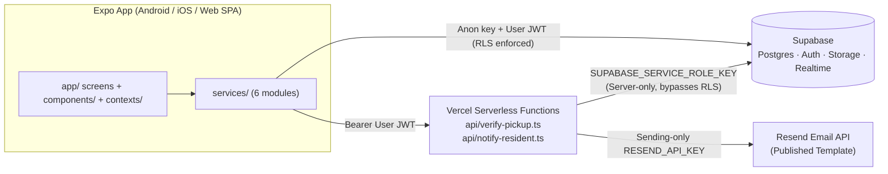
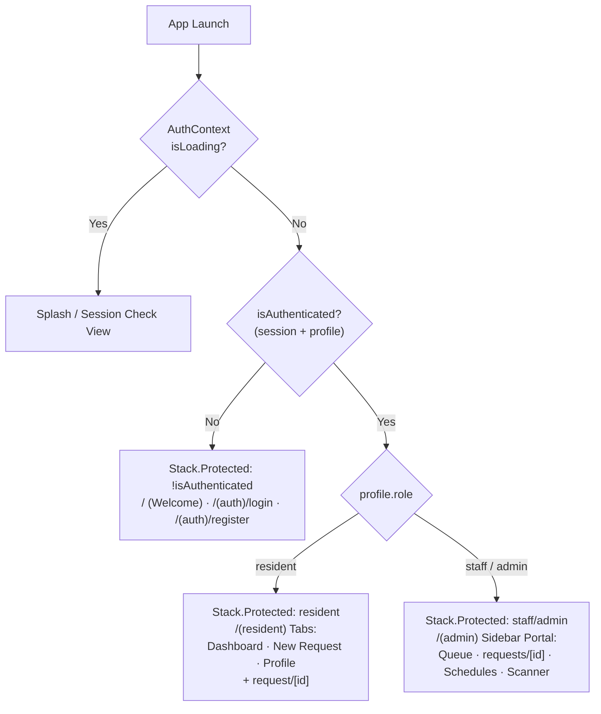

# DocuDash — System Architecture

DocuDash is a cross-platform Expo (Android, iOS, Web) application backed by Supabase (PostgreSQL, Auth, private Storage, Realtime) and Vercel Serverless Functions. The codebase enforces strict separation between UI rendering, client data access, database policy enforcement, and privileged server operations.

---

## 1. High-Level System Diagram



---

## 2. Four-Layer Architecture

### Layer 1 — UI & Routing (`app/`, `components/`, `contexts/`, `constants/`)
- Responsible exclusively for rendering, user input validation feedback, and navigation.
- **Zero direct Supabase imports:** Screens and components never import `@supabase/supabase-js` or construct queries; all reads, mutations, uploads, and Realtime subscriptions flow through `services/`.
- **Design system:** Light mode only (`#991B1B` crimson primary, `#B91C1C` active/hover, `#FFFFFF` surfaces, `#F8FAFC` muted background, `#E2E8F0` borders, `#0F172A` ink). Tokens are defined once in `tailwind.config.js` and mirrored in `constants/theme.ts`.
- **Icons:** `@expo/vector-icons/MaterialIcons` only; no emojis anywhere in the UI.

### Layer 2 — Client Service Layer (`services/`)
Six focused modules isolate all Supabase SDK and `/api` interactions:
- `services/supabase.ts` — Lazy singleton `SupabaseClient<Database>` using `EXPO_PUBLIC_SUPABASE_URL` and `EXPO_PUBLIC_SUPABASE_ANON_KEY`, platform-aware auth persistence (`AsyncStorage` + `AppState` token auto-refresh on native; SSR-safe `window.localStorage` on web), `ServiceError` normalization, and authenticated `callApi()` for Vercel endpoints.
- `services/authService.ts` — Registration (enforcing explicit RA 10173 consent timestamp, never passing `role`), email/password login, profile loading/updating, logout, and auth session listener.
- `services/requestService.ts` — Document types catalog, request CRUD, disambiguated PostgREST joins (`requests_resident_id_fkey`, `requests_reviewed_by_fkey`), staff workflow transitions, `/api` callers, and Realtime subscriptions.
- `services/storageService.ts` — Path-scoped private uploads (`{user_id}/{request_id}/{unique-filename}` with `upsert: false`), client MIME/size checks (5 MiB), automatic orphan cleanup if metadata insertion fails, and 60-second signed URLs with `attachment_viewed` audit logging.
- `services/scheduleService.ts` — `Asia/Manila` date filtering, staff pickup slot CRUD, atomic `book_pickup_slot` RPC invocation, and Realtime slot capacity updates.
- `services/auditService.ts` — Staff `audit_logs` inserts and staff audit trail queries.

### Layer 3 — Database & Storage Security (`supabase/migrations/`)
The database is the authoritative security boundary:
- RLS enabled on all 6 `public` tables plus `storage.objects`.
- `private` schema holds trigger functions and helpers so PostgREST never exposes them as RPCs.
- Business invariants (workflow transitions, QR generation, atomic capacity locking, append-only audit trail, timestamp integrity, separation of duties) are enforced directly in PostgreSQL triggers and `SECURITY DEFINER` RPCs with pinned `search_path = ''`.

### Layer 4 — Privileged Server API (`api/`)
- Deployed on Vercel (`vercel.json` `functions: { "api/*.ts": { "maxDuration": 10 } }`).
- Shared server-only modules live under `api/_lib/` (ignored by Vercel's function router).
- **Bundle isolation:** `metro.config.js` adds root-anchored `resolver.blockList` regexes excluding `api/` and `supabase/`, preventing accidental client bundling of server code or service-role keys.

---

## 3. Navigation & Role Guard Flow

DocuDash uses Expo Router SDK 58 `<Stack.Protected>` guards in `app/_layout.tsx` backed by `contexts/AuthContext.tsx`:



- Only one route group owning `/` is active at any time, preventing URL collisions and clearing history automatically when auth state changes.
- `app/(admin)/_layout.tsx` repeats the `isAuthenticated && isStaff` check as defense in depth.
- True access control is always enforced on the server (PostgreSQL RLS + Vercel JWT/role checks), never solely in client routing.

---

## 4. End-to-End Request & QR Pickup Lifecycle

```mermaid
sequenceDiagram
  actor Resident
  participant App as Expo Client (services/)
  participant DB as Supabase Postgres & Storage
  actor Staff as Barangay Staff
  participant API as Vercel /api

  Resident->>App: Submit request + upload ID + pick slot
  App->>DB: INSERT public.requests (pending)
  Note over DB: Trigger logs request_created
  App->>DB: Upload to private requirements/{uid}/{reqId}/{file}
  App->>DB: INSERT public.request_attachments
  App->>DB: RPC book_pickup_slot() [FOR UPDATE lock]
  Note over DB: Slot booked_count + 1; logs slot_booked

  Staff->>App: Open request in Admin Portal
  App->>DB: createSignedUrl(..., 60s) + INSERT audit_logs (attachment_viewed)
  Staff->>App: Start Review -> Approve
  App->>DB: UPDATE status = reviewing -> ready
  Note over DB: Trigger generates 43-char CSPRNG qr_token & logs request_approved
  App->>API: POST /api/notify-resident (event: ready)
  API->>DB: Verify staff JWT + log notification_dispatched
  DB-->>Resident: Realtime postgres_changes push (QR pass appears)

  Resident->>Staff: Present QR Pickup Pass at counter
  Staff->>App: Scan QR (CameraView / webcam jsQR / manual)
  App->>API: POST /api/verify-pickup { qrToken }
  API->>DB: Verify staff JWT + RPC verify_pickup() [service_role]
  Note over DB: Atomic ready -> completed, sets completed_at, logs pickup_verified
  API-->>Staff: Hydrated VerifyPickupResponse receipt
```

---

## 5. Cross-Platform Strategy

- **QR Rendering (`components/QrCodeMatrix.tsx`):** Computes the ISO/IEC 18004 matrix via `qrcode` (`errorCorrectionLevel: 'M'`) and renders a single vector `<Path>` via `react-native-svg` across Android, iOS, and Web.
- **QR Scanning:** Metro platform resolution automatically selects:
  - `components/QrScannerView.tsx` on iOS/Android (`expo-camera` `CameraView` with `barcodeScannerSettings={{ barcodeTypes: ['qr'] }}`, microphone disabled via `recordAudioAndroid: false`).
  - `components/QrScannerView.web.tsx` on Web (`navigator.mediaDevices.getUserMedia` + hidden `<canvas>` + `jsqr` frame decoding every 250ms, cleanly stopping camera tracks on pause/unmount).
- **Requirement File Uploads (`expo-document-picker`):** Uses the browser `File` object on web (`asset.file`) and `fetch(asset.uri).arrayBuffer()` on native, passing normalized payloads to `storageService.uploadRequirementAttachment()`.
- **Responsive Admin Shell (`app/(admin)/_layout.tsx`):** Switches at `DESKTOP_BREAKPOINT = 1024px` between a fixed 264px left sidebar and a compact mobile/tablet top navigation bar.
